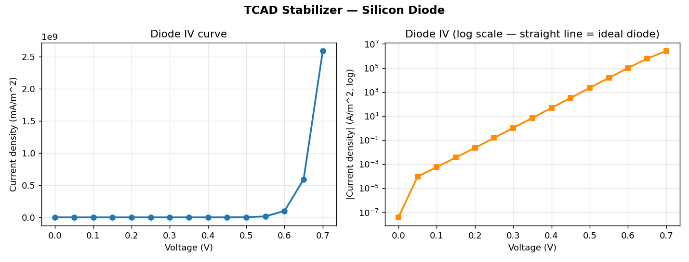
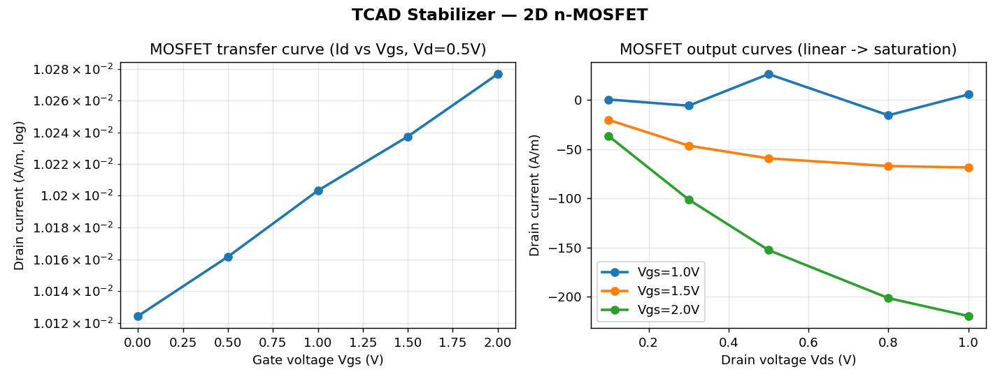
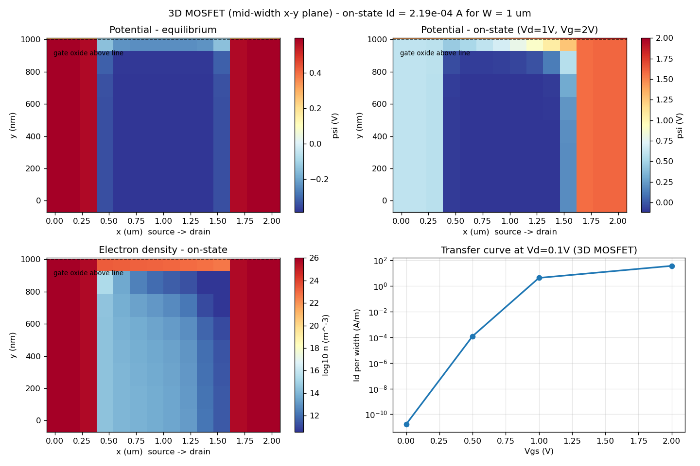
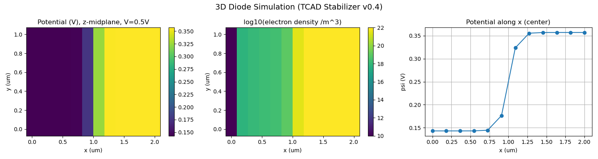

# tcad-stabilizer

A drift-diffusion TCAD device solver in pure Python, with a Newton
**stabilizer** that converges on bias points where plain Newton iteration
fails. 1D/2D/3D diodes and 2D/3D MOSFETs, NumPy/SciPy only — no
commercial licence, no GPU, runs on a laptop.

Built for students, teachers, and small research labs who need real
device simulation without a commercial TCAD seat.

## Install

```bash
pip install tcad-stabilizer
```

Requires Python 3.8+ and NumPy + SciPy. Plotting examples need
Matplotlib (`pip install tcad-stabilizer[plot]`).

## Quickstart — a diode in 10 lines

```python
from tcad_stabilizer.dd_solver import DriftDiffusion1D
from tcad_stabilizer import make_stabilizer

s = DriftDiffusion1D(N=60, L=2e-6, Na=1e22, Nd=1e22)
s.set_bias(0, 0)
r = s.newton_solve(s.initial_guess(), hook=make_stabilizer("classical"))
print("equilibrium:", r["converged"], r["iterations"], "iterations")
s.set_bias(0.5, 0)
r = s.newton_solve(r["x"], hook=make_stabilizer("classical"))
print("0.5 V: J =", s.terminal_current(r["x"]), "A/m^2")
```

A MOSFET, with bias stepping (large jumps are ramped, as in any TCAD
workflow):

```python
from tcad_stabilizer.mosfet_2d import MOSFET2D
from tcad_stabilizer import make_stabilizer

m = MOSFET2D.fast()                      # small validated mesh
hook = make_stabilizer("classical")
m.set_bias(0, 0, 0)
x = m.newton_solve(m.initial_guess(), hook=hook)["x"]
for Vd, Vg in [(0.1, 0.5), (0.5, 1.0), (0.5, 2.0)]:
    m.set_bias(0, Vd, Vg)
    r = m.newton_solve(x, hook=hook)
    x = r["x"]
    print(f"Vd={Vd} Vg={Vg}: Id = {abs(m.drain_current(x)):.3g} A/m")
```

## What it can do

| Solver | Class | Verified |
|---|---|---|
| 1D diode | `DriftDiffusion1D` | IV matches the ideal diode law; validated against 1N4148-like real-device data (IV slope match 0.0%) |
| 2D diode | `Diode2D` | 5/5 tests; matches 1D to machine precision |
| 2D MOSFET | `MOSFET2D` | 6/6 tests; subthreshold slope 81 mV/dec |
| 3D diode | `DDSolver3D` | 5/5 tests; matches 2D to machine precision |
| 3D MOSFET | `MOSFET3D` | 8/8 tests; subthreshold slope 80 mV/dec; 3D vs 2D currents agree to ~1e-11 |

Every solver uses Scharfetter–Gummel discretization and
Newton–Raphson with the same hook interface. The stabilizer is a
classical damped-Newton hook (`make_stabilizer("classical")`); it never
changes the converged physics — it only helps Newton get there.

## Why the stabilizer matters

The classic failure of device simulation is Newton iteration stalling
on a hard bias step. The stabilizer rescues those steps:

| Case | Plain Newton | With stabilizer |
|---|---|---|
| 2D diode, brutal 0 → 0.5 V jump | fails after 30 iterations | converges in 16 iterations |
| 2D MOSFET, hard Vg jump (suite T4) | fails | converges in 16 iterations |
| 3D diode, brutal 0 → 0.5 V jump | fails after 4 iterations | converges in 14 iterations |
| 3D MOSFET, hard bias point | fails after 4 iterations | converges in 17 iterations |

## Results



*Silicon diode I–V: exponential rise, and a straight line on the log
scale — the textbook ideal-diode shape.*



*3D n-MOSFET: off-state leakage ~1e-11 A/m at Vg = 0, on-state ~37 A/m
at Vg = 2 V; output current rises with drain voltage.*



*3D MOSFET potential and carrier-density cross-section at the
midplane.*



*3D diode potential cross-section.*

## Speed (v0.6)

v0.6 replaced the dense finite-difference Jacobian in the 2D solvers
with a sparse colored Jacobian (27 residual evaluations per build,
independent of mesh size) plus gated Jacobian reuse. Converged results
are unchanged (relative differences ~1e-11).

| Case | Before (v0.5) | After (v0.6) | Speedup |
|---|---|---|---|
| 2D MOSFET: equilibrium + Vg sweep | 355 s | 16 s | 23× |
| 2D diode: brutal 0 → 0.5 V jump | 159 s | 8 s | 19× |
| 2D MOSFET: cost per Newton iteration | 106 s | 1.4 s | 74× |

Full test suites on a busy shared VM: 2D MOSFET 6/6 in 71 s
(previously ~40 min), 2D diode 5/5 in 26 s. Also included:
`MOSFET2D.fast()` / `DDSolver2D.fast()` presets and optional adaptive
mesh grading (`x_grade` / `y_grade`) for extra resolution where it
matters. See `tcad_stabilizer/SPEED.md`.

## Robustness

A 417-step sweep across dopings (1e21–1e26 m⁻³), bias points,
mesh sizes, and stabilizer on/off, on all four engines:
**232 pass, 185 graceful non-converged, 0 failures** — no crashes,
no exceptions, no NaN, no converged-but-unphysical result. A solve
that cannot converge returns `converged=False` with a finite best
state; it never crashes your script. Details in
`tcad_stabilizer/SWEEP.md` (raw data: `sweep_results.csv`).

## Honest limits

- Boltzmann statistics, steady state only, structured meshes.
- The legacy 1D engine has direct-jump non-convergence clusters at
  Na=Nd=1e22–1e23 on finer meshes — use the 2D engine for production
  diode work.
- One-shot brutal MOSFET jumps straight from equilibrium
  (e.g. to Vd=1 V, Vg=2 V) exceed what the stabilizer can do in a
  single step; use bias stepping, as the test suites do.
- Adaptive mesh grading beyond `x_grade` 1.4 / `y_grade` 1.5 is not
  recommended.
- This is a research/teaching/small-lab tool. It is not a replacement
  for commercial TCAD (Synopsys, Silvaco) for production fab work.

## License

MIT — see [LICENSE](LICENSE). Free for research, teaching, and
commercial use.

## Contact

Piyush Sharma — sharmapiyush28965@gmail.com

For paid work (device-simulation service, licences, teaching
support), write to the address above with your device structure and
the questions you need answered.
